### ▸ HIGH SCORES

| Project | Built with |
|:--|:--|
| **[POS-FOR-COLLEGE-CANTEEN](https://github.com/Rajshalem5/POS-FOR-COLLEGE-CANTEEN)**  Offline PyQt6 + SQLite point-of-sale: billing, thermal printing, inventory | `Python` |
| **[ANIMATED-PROFILE-CARD](https://github.com/Rajshalem5/ANIMATED-PROFILE-CARD)**  Animated profile card in HTML + CSS, built to be forked and restyled | `CSS` |
| **[dharmafarms](https://github.com/Rajshalem5/dharmafarms)** | `JavaScript` |
| **[BBB-Quiz](https://github.com/Rajshalem5/BBB-Quiz)** | `HTML` |
| **[RAG](https://github.com/Rajshalem5/RAG)** | `Python` |
| **[NETFLIX-HOMEPAGE](https://github.com/Rajshalem5/NETFLIX-HOMEPAGE)** | `HTML` |

Cards are generated from public GitHub data — regenerate with `python assets/generate.py`.
<!-- profile readme -->
