[POS-FOR-COLLEGE-CANTEEN](https://github.com/Rajshalem5/POS-FOR-COLLEGE-CANTEEN) · [ANIMATED-PROFILE-CARD](https://github.com/Rajshalem5/ANIMATED-PROFILE-CARD) · [RAG](https://github.com/Rajshalem5/RAG) · [quizlet](https://github.com/Rajshalem5/quizlet)

<b>▸ EXPERIENCE</b> — 2 roles, expand

**Full Stack Engineer** · Aegion Dynamic Solutions · Jul 2026 – present

- **AnthyOS** — CI/CD translation platform: converts TeamCity and Jenkins pipelines into equivalent GitHub Actions workflows; built the companion desktop app `anthyos-desktop`.
- Pipeline work cut execution from `16m22s` to `10m32s` and cost per run from `$1.26` to `$0.22`.
- **Ruchi** — AI voice kitchen companion: voice interaction workflows, stateful multi-step agents on LangGraph, and a TTS cache that serves audio in ~0 ms against ~1200 ms for fresh synthesis.
- Requirement discussions, technical documentation, MVP builds and product demos with stakeholders.

**Python Full Stack Developer Intern** · Coastal Seven Technologies · Apr 2026

- **Career Portal** — React, Flask, MySQL and REST APIs; resume upload, parsing, structured profile extraction, AI resume scoring and candidate-job matching.
- **Hiring Factory** — Next.js, FastAPI, Supabase, PostgreSQL with JWT auth and RBAC across recruiter, admin, HR, interviewer and candidate roles.

<b>▸ PROJECTS</b> — expand

- **AnySite** — AI tools discovery platform (React, Flask, PostgreSQL, n8n). RAG recommendation workflow: a user's problem becomes a tool sequence.
- **IoT Water Quality Monitor** — ESP8266 + TDS sensors, ThingSpeak dashboards, IFTTT alerts.
- **Library Management System** — MySQL schema and operations for a second-year academic project.

<b>▸ LEADERSHIP</b> — expand

- **President, Entrepreneurship Club** (2024–2025) — ran 5+ workshops on innovation, startup execution and design thinking; led teams of 5–10.
- **Smart India Hackathon 2025** — AI and Product Innovation category.

